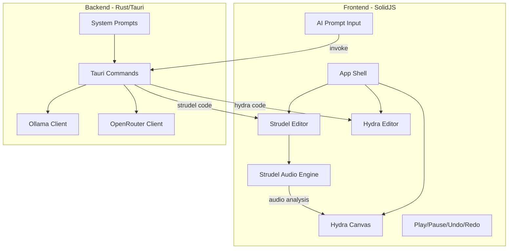

# AuraJam: Strudel + Hydra REPL with AI Code Generation

## Architecture Overview




## Component Breakdown

### 1. Frontend Layout

**View Mode Toggle:**

- **View Mode**: Hydra canvas fullscreen, minimal floating controls
- **Code Mode**: Split view with Strudel editor (left), Hydra editor (right), canvas as background or panel

**Components to create:**

- `src/components/StrudelEditor.tsx` - CodeMirror editor for Strudel patterns
- `src/components/HydraEditor.tsx` - CodeMirror editor for Hydra shaders
- `src/components/HydraCanvas.tsx` - Canvas element for Hydra visuals
- `src/components/Controls.tsx` - Play/pause, undo/redo, view mode toggle
- `src/components/AIPrompt.tsx` - Prompt input, model selector, provider toggle
- `src/components/Settings.tsx` - OpenRouter API key, model preferences

### 2. Strudel Integration

Using `@strudel/web` for custom UI (not iframe):

```typescript
import { initStrudel } from '@strudel/web';

// Initialize once
await initStrudel();

// Execute pattern
note('<c a f e>(3,8)').jux(rev).play();

// Stop
hush();
```

Audio analysis for Hydra reactivity will use Web Audio API's AnalyserNode connected to Strudel's audio context.

### 3. Hydra Integration

Using `hydra-synth` bun package:

```typescript
import Hydra from 'hydra-synth';

const hydra = new Hydra({
  canvas: canvasElement,
  detectAudio: false, // We'll provide our own audio
  enableStreamCapture: false
});

// Audio reactivity - connect Strudel's audio
hydra.setResolution(width, height);
hydra.synth.a.setSmooth(0.8);
hydra.synth.a.setBins(4);
```


### 4. Rust Backend - AI Agents

**Crates to add to [`src-tauri/Cargo.toml`](src-tauri/Cargo.toml):**

- `ollama-rs` - Local Ollama integration
- `openrouter-rs` - OpenRouter API
- `tokio` - Async runtime

**Tauri Commands:**

```rust
#[tauri::command]
async fn generate_code(
    provider: String,      // "ollama" | "openrouter"
    model: String,
    prompt: String,
    agent_type: String,    // "strudel" | "hydra"
    previous_code: Option<String>,
    api_key: Option<String>
) -> Result<String, String>

#[tauri::command]
async fn list_ollama_models() -> Result<Vec<String>, String>
```

**System Prompts** (stored in `src-tauri/src/prompts/`):

- `strudel_agent.txt` - Strudel pattern examples and syntax guide
- `hydra_agent.txt` - Hydra shader examples and syntax guide

### 5. Key NPM Dependencies

use `bun add`

```json
{
  "@strudel/web": "^1.0.0",
  "hydra-synth": "^1.3.29",
  "@codemirror/view": "^6.0.0",
  "@codemirror/state": "^6.0.0",
  "@codemirror/lang-javascript": "^6.0.0"
}
```


## File Structure

```javascript
src/
├── App.tsx                    # Main app with mode switching
├── App.css                    # Global styles
├── components/
│   ├── StrudelEditor.tsx
│   ├── HydraEditor.tsx
│   ├── HydraCanvas.tsx
│   ├── Controls.tsx
│   ├── AIPrompt.tsx
│   └── Settings.tsx
├── lib/
│   ├── strudel.ts            # Strudel init and helpers
│   ├── hydra.ts              # Hydra init and audio bridge
│   └── audio-bridge.ts       # Connect Strudel audio to Hydra
└── stores/
    └── app.ts                # SolidJS stores for state

src-tauri/src/
├── lib.rs                    # Tauri commands
├── ai/
│   ├── mod.rs
│   ├── ollama.rs             # Ollama client
│   └── openrouter.rs         # OpenRouter client
└── prompts/
    ├── strudel_agent.txt
    └── hydra_agent.txt

```